# Heatsheet

School sports event manager built with Flutter and Riverpod: run a full sports day, house competitions and inter-school tournaments from one app, with results that update the house standings and the big-screen board the moment they are entered.

## Demo

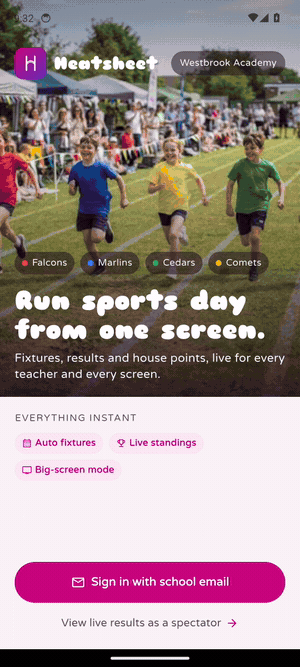

Captured on an Android emulator. The same codebase builds for iOS.

## What it shows

- **Live event dashboard**: event progress (14 of 32 events, 44%), events running now, results waiting to be entered, live house totals and what is up next, designed for one-tap use during a busy event.
- **Fast result entry**: an official times a 100m heat lane by lane (simulated stopwatch, nudge by 0.01 s, did-not-start), lanes re-rank as each time comes in, house points for placing (10, 8, 6, 4, 2, 1) preview before submit. Field events use the same screen with distances, longest first.
- **Points that move everything**: submitting a heat updates house totals, medal table, event progress and the display board straight away.
- **Fixtures and scheduling**: round robin fixtures generated with the circle method (15 matches over 5 rounds for 6 teams, no team on two courts at once), regenerate while keeping played results, long-press and drop to swap two matches, a live league table (win 3, draw 1, loss 0, then difference).
- **Competition formats**: a one-screen wizard for round robin, league (home and away), knockout (seeded bracket) and groups + knockout, with third-place match, points and team count.
- **Knockout bracket**: quarter-finals to the final with connector lines, penalties when level, winners advance on save, third-place match fills from the semi-final losers.
- **Sports day schedule**: four stations on a timeline, with clash detection (a student entered in two events at the same time on different stations) and a one-tap fix that moves the later event to the first free slot.
- **Standings and display mode**: podium, points bars, medal table, league tables, and a full-screen leaderboard for a projector or hall TV with the latest result, what is next and announcements.
- **Houses, classes and teams**: four houses with captains and rosters, year groups and house teams.
- **Roles and permissions**: school admin, organiser, official and spectator. Spectators see live scores only; staff access is toggled per permission.
- A first-run state for a school with no events yet.

## Screenshots

| Welcome | Role | Live dashboard | Enter times |
|---|---|---|---|
| 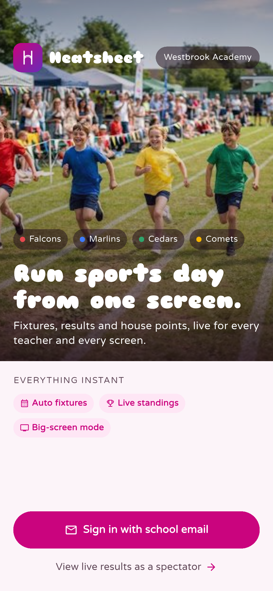 | 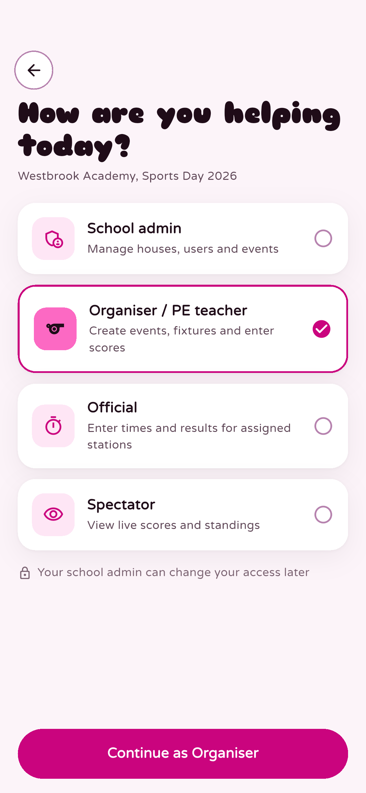 | 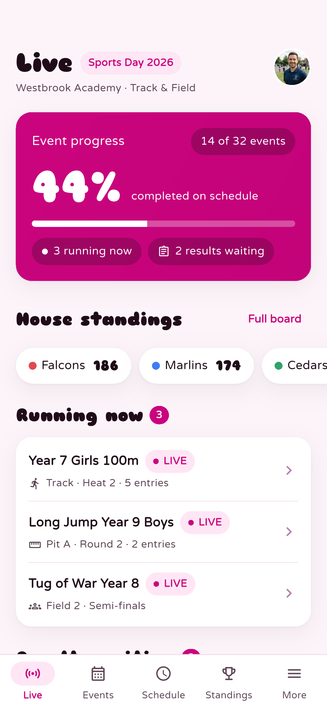 | 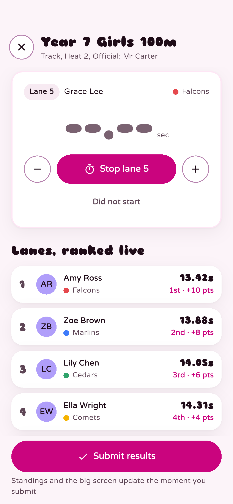 |

| Events | New competition | Schedule | Fixtures |
|---|---|---|---|
| 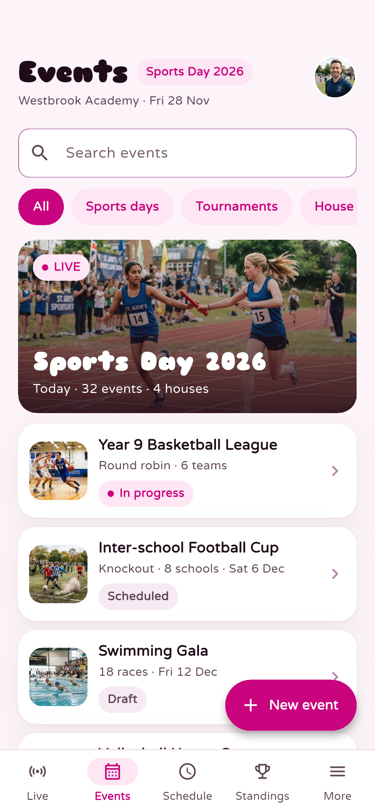 | 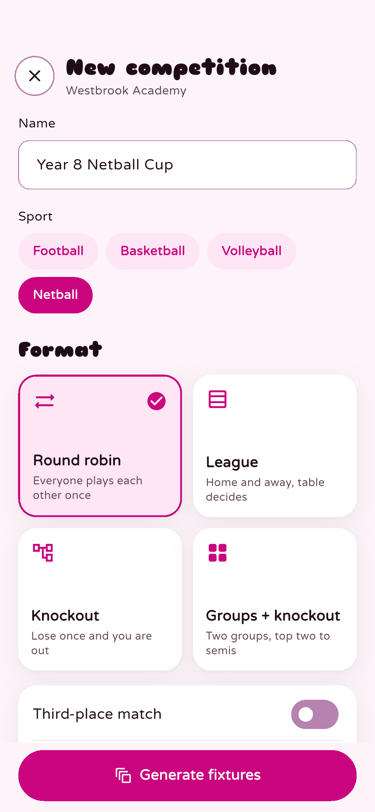 | 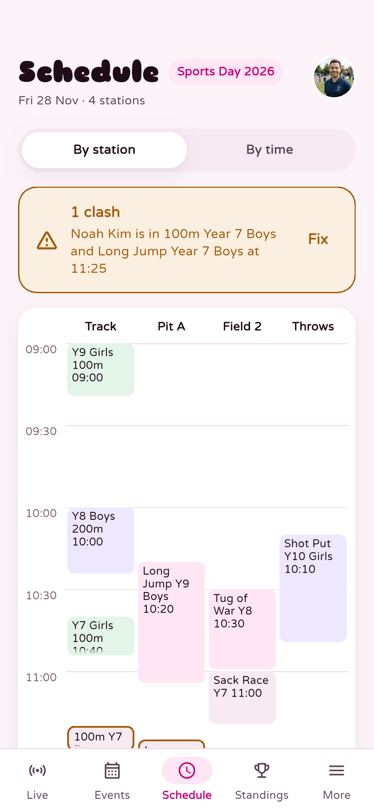 | 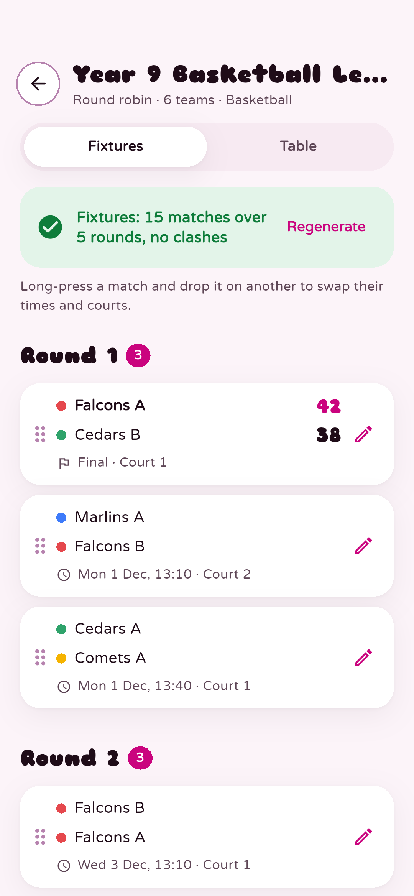 |

| Match score | Bracket | Standings | Display mode |
|---|---|---|---|
| 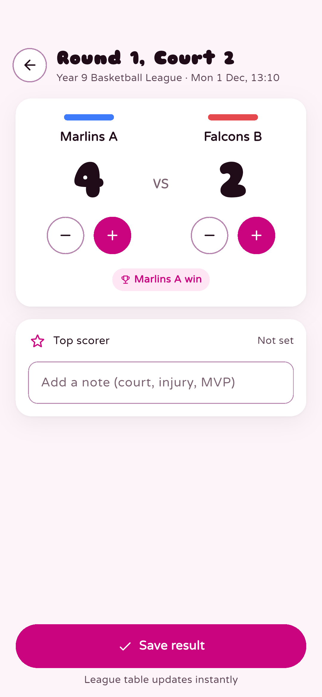 | 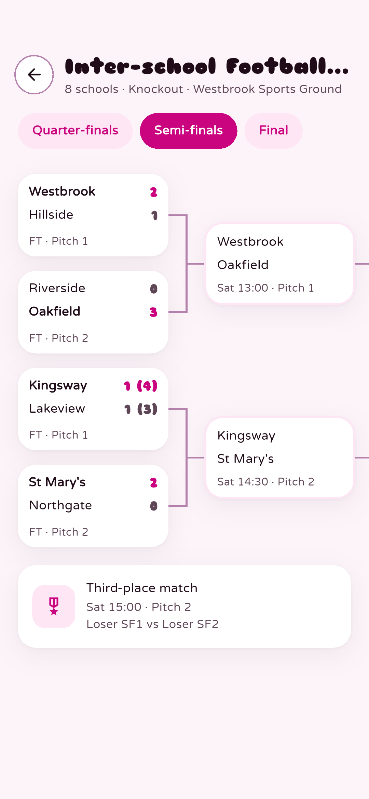 | 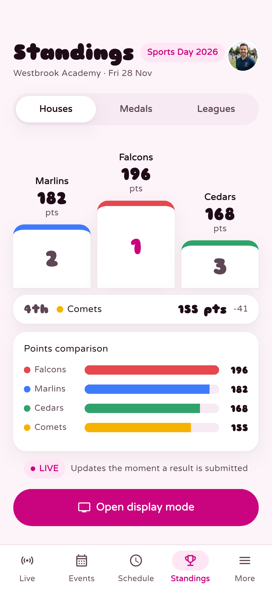 | 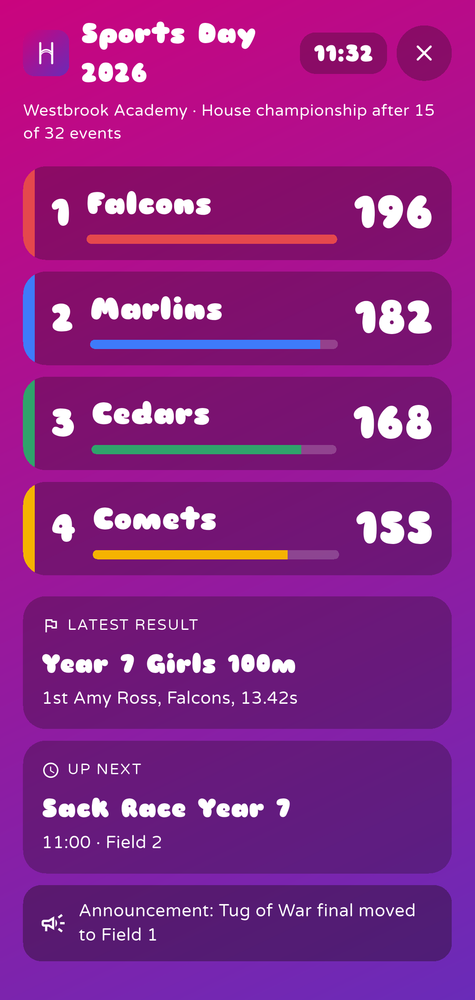 |

| Houses and teams | Staff and roles | First run |
|---|---|---|
| 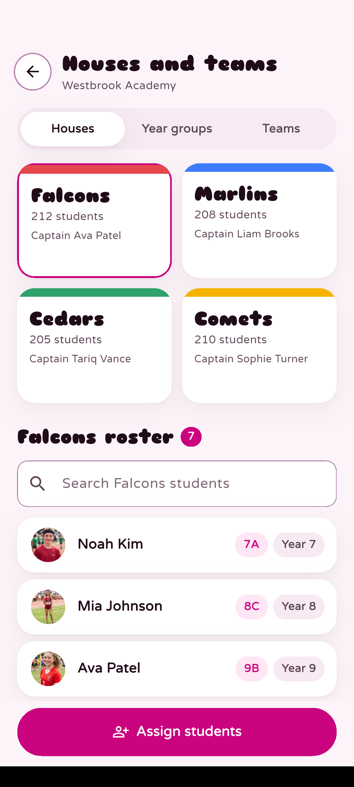 | 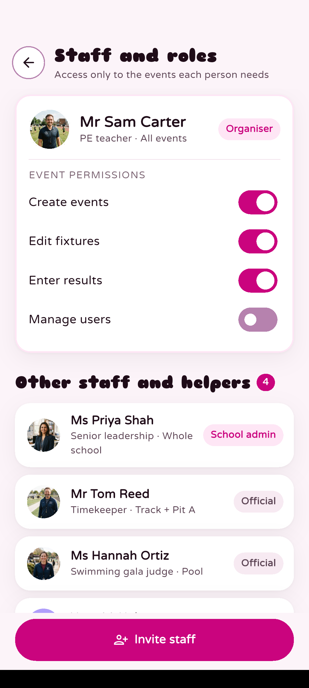 | 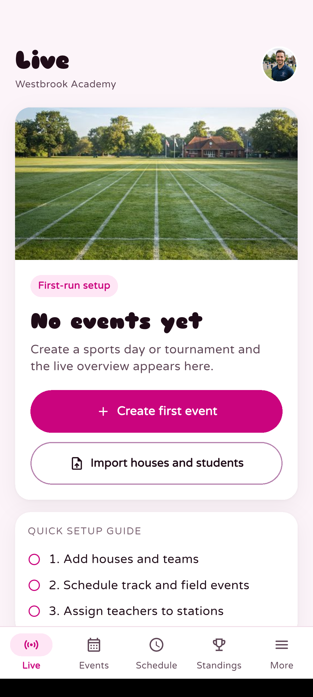 |

## App flow

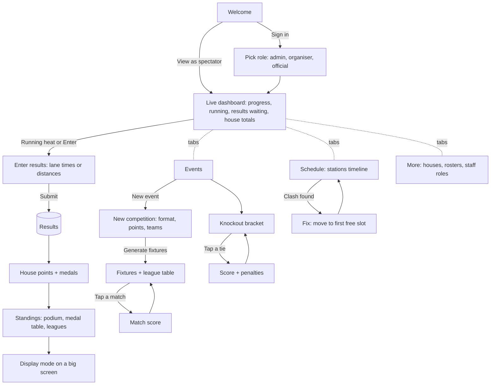

## Architecture

```
lib/
  domain/models.dart     houses, athletes, events, entries, matches, ties, roles
  domain/engine.dart     ranking + placing points, house totals, round robin, league table,
                         knockout seeding + advance, clash detection + fix
  data/sample_data.dart  one school's sports day, a basketball league, a football cup, staff
  state/providers.dart   Riverpod Notifiers: role, sports day, standings, competitions, cup, staff
  core/                  design tokens from the Stitch design, shared controls
  features/              live, results, events, fixtures, bracket, schedule, standings, more, shell
design/                  the Stitch screens (HTML + PNG) the UI was built from
integration_test/        screenshot walk and paced demo used for the media above
```

- **State**: Riverpod 3 `Notifier`s. Standings, progress and clashes are derived providers, so one submitted heat updates the dashboard, the podium and the display board with no extra wiring.
- **Logic is plain Dart** in `domain/engine.dart` and unit tested (`test/engine_test.dart`): ties share a place and its points, DNS scores nothing, odd team counts get byes, no team plays twice in a slot, the clash fix never creates a new clash.
- **Mock data only**: no backend, no accounts. The stopwatch and tape reads are simulated behind a tap.
- **Design**: Varela Round for UI, Sniglet for titles and numbers, bubble pink on a tinted near-white, house colours always shown with the house name.

## Run

```sh
flutter pub get
flutter run            # Android emulator or iOS simulator
flutter test           # engine unit tests + widget tests for every key screen
```

Built with Flutter 3.35 and Dart 3.9.
